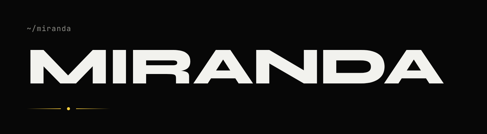

<picture>
  <source media="(prefers-color-scheme: light)" srcset="assets/banner-light.png">
  
</picture>

desenvolvedor e estudante de engenharia de computação.

● dev na ventrium · lançando o easybeach

 

### agora

- dev na ventrium, desde set/2026
- lançando o [easybeach](https://easybeach.app), com a turma
- engenharia de computação, ifrj

 

### projetos

| | |
|---|---|
| [easybeach](https://easybeach.app) | condições das praias de niterói em tempo real. ios e android |
| [acervif](https://acervif.site) · [github](https://github.com/carlosmirandd/acervif) | acervo de provas, horários e avisos para engenharia do ifrj. pwa com firebase e vercel |
| [inova ligas](https://instagram.com/inovanit.ifrj) | gestão de equipes e competições de inovação. react e supabase |
| [chiquinhaflix](https://carlosmirandd.github.io/chiquinhaflix) · [github](https://github.com/carlosmirandd/chiquinhaflix) | visualizador de séries com modo tv, em js puro |

 

### stack

| | |
|---|---|
| web |        |
| mobile |    |
| dados |     |
| infra |      |
| ia |    |
| criação |     |
| no-code |    |
| hardware |   |
| aprendendo |   |

tudo que já usei

 

- **web**: html, css, javascript, typescript, react, next.js, tailwind, vite, php, node.js, python
- **mobile**: capacitor, flutter e dart, pwa, react native (usei, hoje lembro menos). kotlin e swift estou aprendendo, a ia escreve quase tudo
- **dados**: supabase, firebase, postgresql, mysql
- **infra**: git, github actions, docker, rest e postman, vercel, cloudflare
- **linux**: ubuntu, debian, zorin, pop!_os e kali, termux no celular e wsl com ubuntu no windows
- **ia**: claude (code e projects) e gemini no dia a dia. claude na ventrium e openai no easybeach, para resumos e moderação
- **criação**: figma, canva, lightroom e capcut
- **no-code**: wordpress, framer, webflow, wix e nuvemshop, com noção prática
- **hardware e redes**: arduino e esp32, redes só nos fundamentos do ccna

 

  

 

### contato

[carlosmiranda.trabalhos@gmail.com](mailto:carlosmiranda.trabalhos@gmail.com)

 

### atividade

<picture>
  <source media="(prefers-color-scheme: dark)" srcset="https://raw.githubusercontent.com/carlosmirandd/carlosmirandd/pacman-output/bomberman-contribution-graph-dark.svg?game=bomberman">
  <source media="(prefers-color-scheme: light)" srcset="https://raw.githubusercontent.com/carlosmirandd/carlosmirandd/pacman-output/bomberman-contribution-graph.svg?game=bomberman">
  
</picture>

  
  

  

